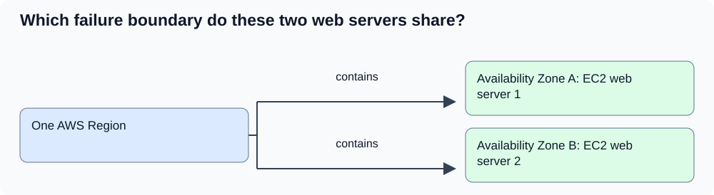
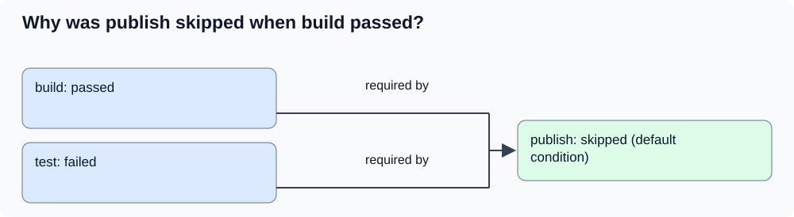
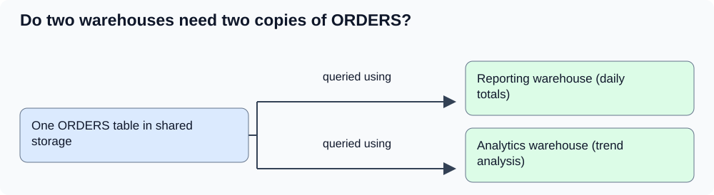
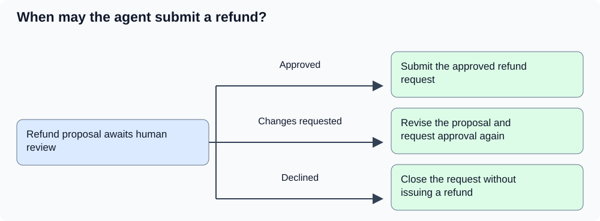

# Four inline diagram previews

**November 20, 2026 · Independent AI-assisted drafts · Human review pending.**
These examples try the same [inline diagram workflow](../STUDY-PRODUCTION.md#add-an-inline-guide-diagram)
on one learner question per certification. The linked official exam guides define the scope.

## AWS Cloud Practitioner (CLF-C02)



Both EC2 web servers depend on the same Region. If an outage is confined to Zone A,
server 2 is outside the affected zone. A Region-wide outage can affect both.
Keeping the application available also requires healthy dependencies and a way
to route requests to the surviving server. [Open full-size diagram](../../guides/diagrams/clf-c02/zone-placement.svg) · [AWS Regions and Availability Zones](https://docs.aws.amazon.com/global-infrastructure/latest/regions/aws-regions-availability-zones.html)

Intended placement is **Global infrastructure**. The accepted snapshot records Domain 3
at the domain level. Task 3.2 in the official blueprint covers Region and zone relationships.
[Library guide](../../guides/CLF-C02-aws-certified-cloud-practitioner.md#global-infrastructure) · [Official exam domain](https://docs.aws.amazon.com/aws-certification/latest/cloud-practitioner-02/cloud-practitioner-02-domain3.html) · [Diagram definition](../../guides/diagrams/clf-c02/zone-placement.json)

## GitHub Actions (GH-200)



Follow the two prerequisites into `publish`. In this example, its declaration
`needs: [build, test]` requires both to succeed under the default condition.
`build` passed, but `test` failed, so GitHub skips `publish`. An explicit job
condition can change this behavior. [Open full-size diagram](../../guides/diagrams/gh-200/publish-dependencies.svg) · [GitHub job dependency reference](https://docs.github.com/en/actions/reference/workflows-and-actions/workflow-syntax#jobsjob_idneeds)

Intended placement is **Design the dependency graph explicitly**, under the
objective **Implement dependencies between jobs**. [Library guide](../../guides/GH-200-github-actions.md#design-the-dependency-graph-explicitly) · [Official exam guide](https://learn.microsoft.com/en-us/credentials/certifications/resources/study-guides/gh-200) · [Diagram definition](../../guides/diagrams/gh-200/publish-dependencies.json)

## SnowPro Core (COF-C03)



The reporting team calculates daily totals and the analytics team looks for trends.
With the appropriate access, both can query the same stored `ORDERS` table.
Each warehouse supplies its own compute. Adding the second warehouse requires
no second copy of the table. [Open full-size diagram](../../guides/diagrams/cof-c03/shared-table.svg) · [Snowflake storage and compute architecture](https://docs.snowflake.com/en/user-guide/intro-key-concepts)

Intended placement is **Reason across the three service layers**, under the
objective **Use the Snowflake AI Data Cloud architecture**. [Library guide](../../guides/COF-C03-snowpro-core.md#reason-across-the-three-service-layers) · [Official exam overview](https://learn.snowflake.com/en/certifications/snowpro-core-c03/) · [Diagram definition](../../guides/diagrams/cof-c03/shared-table.json)

## Microsoft Agentic AI Business Solutions Architect (AB-100)



In this example, a retailer lets an agent prepare a refund and requires a human
to approve the amount before submission. If the reviewer asks for a different
amount, the agent revises the proposal and brings it back for approval. If the
reviewer declines, the request closes. [Open full-size diagram](../../guides/diagrams/ab-100/refund-approval.svg) · [Microsoft guidance on human participation](https://learn.microsoft.com/en-us/azure/architecture/ai-ml/guide/ai-agent-design-patterns#human-participation)

Intended placement is **Design human intervention as a real control**. The
objective **Design governance for agents** appears in the July 22 outline used
for the trial and in the current November 16, 2026 outline.
[Library guide](../../guides/AB-100-agentic-ai-business-solutions-architect.md#design-human-intervention-as-a-real-control) · [Official exam guide](https://learn.microsoft.com/en-us/credentials/certifications/resources/study-guides/ab-100) · [Diagram definition](../../guides/diagrams/ab-100/refund-approval.json)

## Reproduce the previews

From the repository root, run the following checks. To regenerate any SVG from
its JSON definition, run the same command without `--check`.

```powershell
python scripts/build_guide_diagram.py guides/diagrams/clf-c02/zone-placement.json --check
python scripts/build_guide_diagram.py guides/diagrams/gh-200/publish-dependencies.json --check
python scripts/build_guide_diagram.py guides/diagrams/cof-c03/shared-table.json --check
python scripts/build_guide_diagram.py guides/diagrams/ab-100/refund-approval.json --check
```

## Trial review

The author checked the rendered labels, arrow directions, text equivalents,
and linked product documentation. Each SVG reproduced byte for byte from its
definition. One fresh-context AI reviewer checked the first three figures and
captions against the complete source guides, accepted objectives and official
references. A separate reviewer checked AB-100 against its guide, both dated
outlines and Microsoft's human-participation guidance. The AWS
alt text now identifies the two zones used in this example. The GitHub figure
now follows both prerequisites into a single publish job.

The Snowflake trial exposed a filename mismatch that matters on case-sensitive
filesystems. The builder now uses the capitalization of the stored objective file.
A regression test on Windows checked that spelling and verified that an older
package manifest still detects a changed snapshot. Human learner feedback and
live product exercises remain pending.
