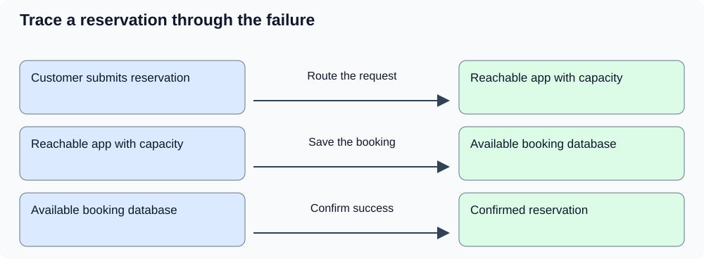
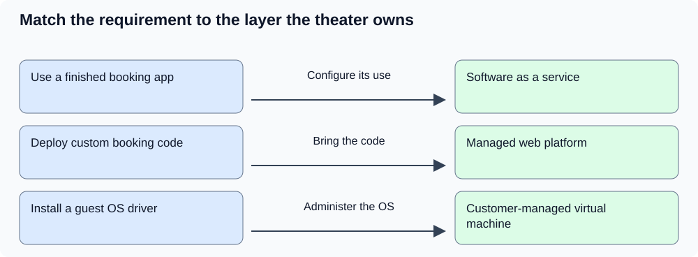

# AZ-900 — Microsoft Azure Fundamentals: visual study pack

> **Independent AI-assisted resource — AI-GENERATED DRAFT; HUMAN REVIEW PENDING. Structural checks do not establish factual accuracy or renew source review. The official exam blueprint is authoritative.**

[Official exam blueprint](https://learn.microsoft.com/en-us/credentials/certifications/resources/study-guides/az-900)

[Full library guide](https://github.com/cterpening/certification-study-library/blob/main/guides/AZ-900-microsoft-azure-fundamentals.md) (current repository version; this package's exact source hash is recorded in manifest.json).

**Accepted objective baseline:** Skills measured as of July 20, 2026

**Blueprint last checked in the catalog:** 2026-10-28. This build performs no live source refresh.

**Scope:** Two decisions in Azure fundamentals: keeping reservations available during a location failure and choosing who maintains a ticketing application. These cases cover selected public objectives.

**VERIFY CURRENT:** Recheck volatile product details and unresolved limitations in the source guide. A matching file hash does not establish current technical accuracy.

## Can the booking desk stay open when a zone goes down?

Follow a customer reserving a bicycle. Two web servers can share a point of failure, and a healthy web page can hide a broken reservation system. Decide what must survive by tracing the customer's whole booking through the affected location.

**Supporting sources:** [List of Azure regions](https://learn.microsoft.com/en-us/azure/reliability/regions-list), [Azure paired and nonpaired regions](https://learn.microsoft.com/en-us/azure/reliability/regions-paired), [Azure reliability documentation](https://learn.microsoft.com/en-us/azure/reliability/)

**Published objectives:**

- Describe availability zones
- Describe Azure datacenters
- Describe the benefits of high availability and scalability in the cloud

**Source-guide sections:** Regions, availability zones, and datacenters; Design from geography to resource; Separate the cloud benefits

**Diagram in words:** Customer submits reservation — Route the request → Reachable app with capacity; Reachable app with capacity — Save the booking → Available booking database; Available booking database — Confirm success → Confirmed reservation

**Remember:**

- A datacenter houses equipment. An availability zone groups one or more datacenters within an Azure region and has independent power, cooling and networking.
- A zonal resource occupies a chosen zone. With a supported zone-redundant configuration, the service distributes or replicates the resource across zones. The application still depends on every service needed to complete a booking.
- Scaling adds capacity. Resilience to a zone outage also depends on where that capacity runs, how customers reach it and where their records are stored.
- A region-wide outage requires a recovery plan that works outside the affected region. Region pairing alone does not replicate an entire workload or route its users.
- VERIFY CURRENT: Check zone support and the reliability guidance for each service, region and deployment configuration.

**Try it:** The booking app has capacity for 60 reservations per minute in each of two zones. Demand is 80 per minute. What happens to the capacity target if one zone goes offline? What else must work for customers still to reserve a bike?

**Answer and reasoning:** Only 60 reservations per minute of app capacity remain, leaving a shortfall of 20 per minute. Plan for sufficient surviving capacity, a functioning route and a booking database that can still serve the application. Verify a complete booking under the failure condition.

## Who patches the ticket counter?

A ticket office can buy a finished reservation service, deploy its own web app on a managed platform, or administer a virtual machine. Trace which layer the team needs to control and which jobs stay on its maintenance calendar.

**Supporting sources:** [Shared responsibility in the cloud](https://learn.microsoft.com/en-us/azure/security/fundamentals/shared-responsibility), [Choose an Azure compute service](https://learn.microsoft.com/en-us/azure/architecture/guide/technology-choices/compute-decision-tree), [Azure Virtual Machines overview](https://learn.microsoft.com/en-us/azure/virtual-machines/overview)

**Published objectives:**

- Describe the shared responsibility model
- Describe infrastructure as a service (IaaS)
- Describe platform as a service (PaaS)
- Describe software as a service (SaaS)
- Identify appropriate use cases for each cloud service type (IaaS, PaaS, and SaaS)

**Source-guide sections:** Shared responsibility; IaaS, PaaS, SaaS, and serverless; Turn a cloud requirement into a responsibility decision; Select compute by control, orchestration, and workload shape

**Diagram in words:** Use a finished booking app — Configure its use → Software as a service; Deploy custom booking code — Bring the code → Managed web platform; Install a guest OS driver — Administer the OS → Customer-managed virtual machine

**Remember:**

- Software as a service provides a finished application. The customer configures its use, manages its users and protects its data.
- With Azure App Service as a managed platform for application code, Microsoft manages the underlying operating system. The application team remains responsible for its own code, dependencies, data, access and settings.
- An Azure virtual machine provides control over the guest operating system. The customer is responsible for maintaining it and the application, while Microsoft operates the physical host and facility.
- Start with the requirement that forces control of a particular layer. Ask which work can move to the provider and which tasks the team must still own.

**Try it:** A theater can deploy its booking code to a supported managed web platform. A new vendor component requires an administrator to install an operating-system driver, and the component must run on the same machine. Which hosting choice now deserves evaluation, and who maintains the operating system?

**Answer and reasoning:** Evaluate an Azure virtual machine with a supported guest operating system and confirm driver compatibility. The theater gains guest-level control and takes responsibility for guest patching, its own application and its data. Microsoft maintains the physical host.

## Places to learn

The linked source guide and registered references are a curated starting point, not a complete list or a requirement to consume everything. This focused pack does not replace the complete guide or official objectives.
