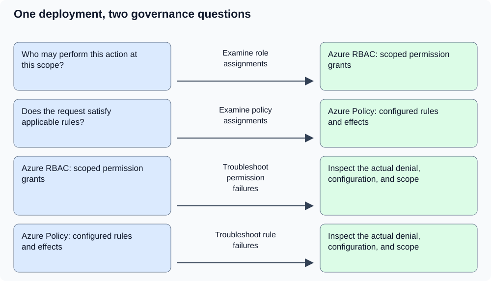
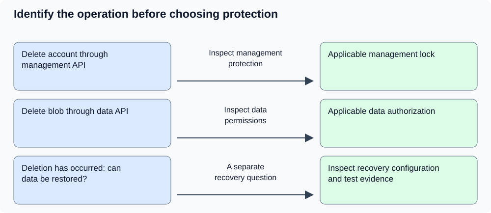
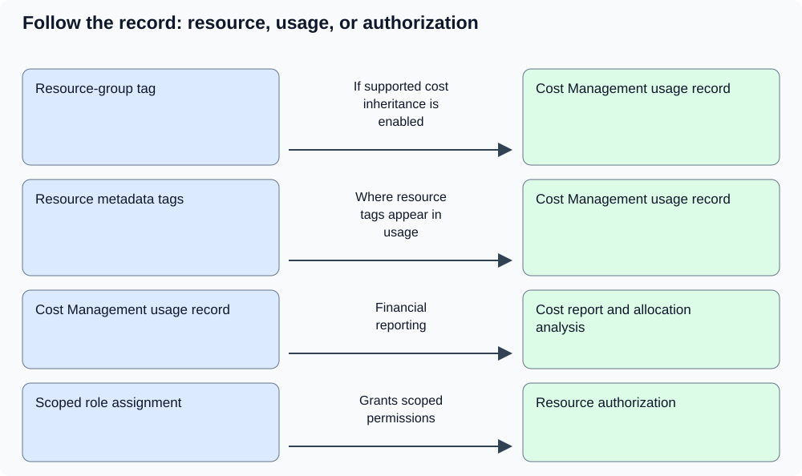

# AZ-900 — Microsoft Azure Fundamentals: visual study pack

> **Independent AI-assisted resource — AI-GENERATED DRAFT; HUMAN REVIEW PENDING. Structural checks do not establish factual accuracy or renew source review. The official exam blueprint is authoritative.**

[Official exam blueprint](https://learn.microsoft.com/en-us/credentials/certifications/resources/study-guides/az-900)

[Full library guide](https://github.com/cterpening/certification-study-library/blob/main/guides/AZ-900-microsoft-azure-fundamentals.md) (current repository version; this package's exact source hash is recorded in manifest.json).

**Accepted objective baseline:** Skills measured as of July 20, 2026

**Blueprint last checked in the catalog:** 2026-10-28. This build performs no live source refresh.

**Scope:** Three selected governance distinctions: permissions and Policy, management locks and data protection, and tags and cost allocation. This companion does not cover the entire AZ-900 exam. Technical evidence for these distinctions was checked on November 10, 2026; human review and live Azure execution remain pending.

**VERIFY CURRENT:** Recheck volatile product details and unresolved limitations in the source guide. A matching file hash does not establish current technical accuracy.

## Azure RBAC and Azure Policy answer different questions

Separate permission to perform an action from the governance requirements that also apply to the request. Azure role-based access control grants permissions through role assignments at a scope. Azure Policy applies configured governance rules and effects. A permission grant does not exempt a deployment from an applicable policy denial.

**Supporting sources:** [What is Azure role-based access control?](https://learn.microsoft.com/en-us/azure/role-based-access-control/overview), [What is Azure Policy?](https://learn.microsoft.com/en-us/azure/governance/policy/overview), [Remediate resources with Azure Policy](https://learn.microsoft.com/en-us/azure/governance/policy/how-to/remediate-resources)

**Published objectives:**

- Describe Azure role-based access control (RBAC)
- Describe the purpose of Azure Policy

**Source-guide sections:** Authentication and authorization; Governance controls; Apply governance controls at the correct scope; Worked example 6 — permission, policy, lock and data protection

**Diagram in words:** Who may perform this action at this scope? — Examine role assignments → Azure RBAC: scoped permission grants; Does the request satisfy applicable rules? — Examine policy assignments → Azure Policy: configured rules and effects; Azure RBAC: scoped permission grants — Troubleshoot permission failures → Inspect the actual denial, configuration, and scope; Azure Policy: configured rules and effects — Troubleshoot rule failures → Inspect the actual denial, configuration, and scope

**Remember:**

- An Azure RBAC role assignment connects a security principal, a role definition, and a scope. Successful sign-in alone does not establish permission for a requested resource operation.
- Policy behavior depends on the definition, assignment scope, exclusions or exemptions, and effect. Audit and deny have different outcomes; a noncompliance finding is not proof that a resource has been repaired.
- Supported remediation needs the appropriate configuration, task, and permissions. Inspect the result instead of equating a policy assignment with a successful repair.
- VERIFY CURRENT: Policy capabilities and effects evolve. Avoid the absolute claim that Policy never considers identity; the current overview also documents identity-aware rules.
- The diagram maps questions to controls. It is not an asserted execution order, and other service checks can also affect a request.

**Try it:** A deployment identity has permission to create resources in a project resource group. An applicable policy denies creation outside approved locations, and the deployment selects another location. Should the team solve this by expanding the identity's role?

**Answer and reasoning:** No. The stated failure is the configuration restriction. Select an approved location or follow the organization's legitimate exception process. Broader RBAC permissions do not resolve that policy denial. Inspect the actual error, requested configuration, and applicable scope before changing access.

## A management lock is not a data-recovery plan

Resource locks restrict management operations at their scope. Protecting a resource's contents also requires understanding data operations and recovery. A delete lock on a storage account does not prevent an authorized application from deleting a blob through the data plane.

**Supporting sources:** [Lock Azure resources to protect infrastructure](https://learn.microsoft.com/en-us/azure/azure-resource-manager/management/lock-resources)

**Published objectives:**

- Describe the purpose of resource locks

**Source-guide sections:** Governance controls; Select storage from data shape through recovery; Worked example 6 — permission, policy, lock and data protection; Lab 6: Offline cost and control worksheet

**Diagram in words:** Delete account through management API — Inspect management protection → Applicable management lock; Delete blob through data API — Inspect data permissions → Applicable data authorization; Deletion has occurred: can data be restored? — A separate recovery question → Inspect recovery configuration and test evidence

**Remember:**

- CanNotDelete and ReadOnly are different lock levels. Examine inherited locks when an otherwise authorized management operation fails.
- Identify the operation and its API boundary. A management lock on a storage account and authorization for a data-plane blob operation address different concerns.
- Related item: A recovery plan needs its own controls and evidence. A locked resource is not proof that deleted data can be restored.
- VERIFY CURRENT: Check the documented operation-specific lock effects and service exceptions before applying a lock to a workload.
- The diagram separates management protection, data authorization, and recovery investigation. It does not claim that a recovery mechanism has been configured or tested.

**Try it:** A storage account has a delete lock. An application is authorized to delete blobs and deletes one through the Blob service API. Does the lock guarantee that the document remains available?

**Answer and reasoning:** No. The account lock restricts management-plane operations. The blob deletion is a data-plane operation. Whether the document can be recovered depends on the applicable data-protection configuration and its limits; the label locked does not establish that recovery is possible.

## Resource tags, cost records, and access are separate

A cost-center label helps organize ownership and spending. It does not itself grant access, automatically copy onto child resources, or decide how a shared bill should be divided. Resource metadata and Cost Management usage records can legitimately carry different tag information.

**Supporting sources:** [Resource tags and inheritance](https://learn.microsoft.com/en-us/azure/azure-resource-manager/management/tag-resources), [Cost Management tag inheritance](https://learn.microsoft.com/en-us/azure/cost-management-billing/costs/enable-tag-inheritance), [What is Azure role-based access control?](https://learn.microsoft.com/en-us/azure/role-based-access-control/overview), [What is Azure Policy?](https://learn.microsoft.com/en-us/azure/governance/policy/overview)

**Published objectives:**

- Describe the purpose of tags
- Describe cost management capabilities in Azure

**Source-guide sections:** Cost management; Budgets, limits, commitments and tags; Governance controls; Worked example 3 — allocate shared cost without changing access

**Diagram in words:** Resource-group tag — If supported cost inheritance is enabled → Cost Management usage record; Resource metadata tags — Where resource tags appear in usage → Cost Management usage record; Cost Management usage record — Financial reporting → Cost report and allocation analysis; Scoped role assignment — Grants scoped permissions → Resource authorization

**Remember:**

- Parent tags are not automatically inherited as tags on child resources. Inspect resource metadata when checking a resource-tag requirement.
- Cost Management tag inheritance, when enabled and supported, enriches usage records rather than changing the resources themselves.
- A cost report is not evidence that every resource has the required tag. Inspect each relevant record for the question being asked.
- VERIFY CURRENT: Check supported billing scopes and configuration for Cost Management tag inheritance.
- A tag alone does not grant resource access. A shared-cost allocation needs an explicit business rule; the arithmetic example is an original illustration, not an Azure allocation default.

**Try it:** A cost report groups spending under CostCenter=Research, but the virtual machine lacks that resource tag. Is either observation necessarily wrong?

**Answer and reasoning:** No. Supported Cost Management tag inheritance can add a parent label to the usage record without changing the virtual machine's metadata. Inspect the resource separately if a policy requires the resource tag. A financial classification does not establish either resource-tag compliance or access permissions.

## Places to learn

The linked source guide and registered references are a curated starting point, not a complete list or a requirement to consume everything. This focused pack does not replace the complete guide or official objectives.
