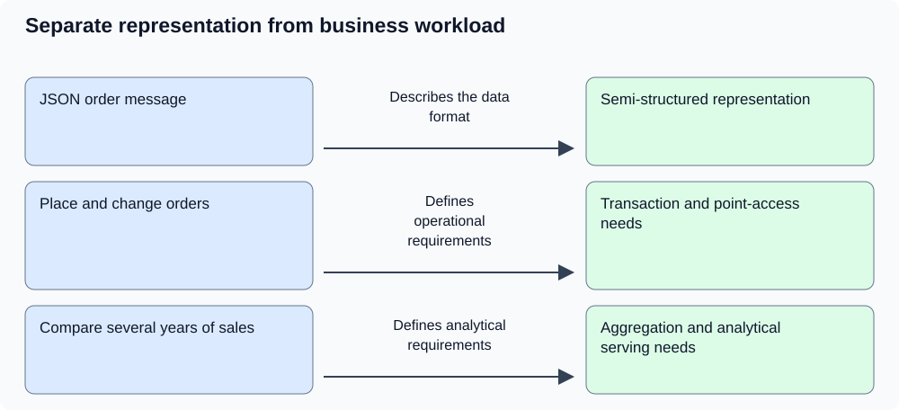
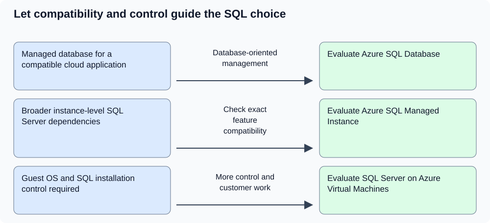
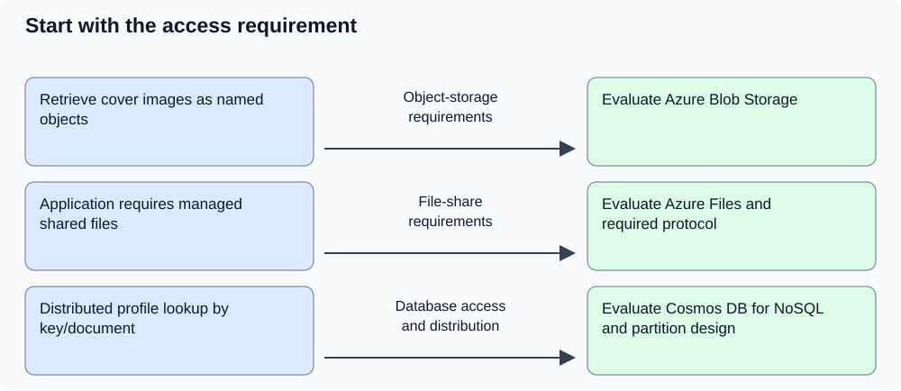
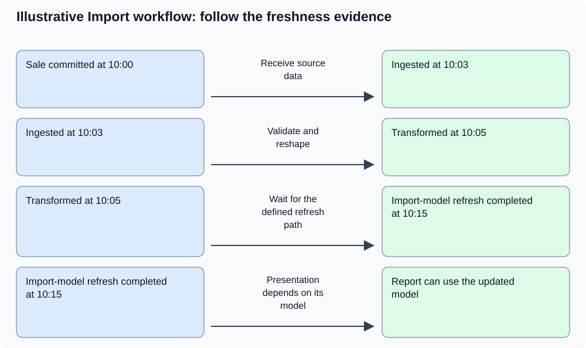

# DP-900 — Microsoft Azure Data Fundamentals: visual study pack

> **Independent AI-assisted resource — AI-GENERATED DRAFT; HUMAN REVIEW PENDING. Structural checks do not establish factual accuracy or renew source review. The official exam blueprint is authoritative.**

[Official exam blueprint](https://learn.microsoft.com/en-us/credentials/certifications/resources/study-guides/dp-900)

[Full library guide](https://github.com/cterpening/certification-study-library/blob/main/guides/DP-900-microsoft-azure-data-fundamentals.md) (current repository version; this package's exact source hash is recorded in manifest.json).

**Accepted objective baseline:** Skills measured as of July 21, 2026

**Blueprint last checked in the catalog:** 2026-10-28. This build performs no live source refresh.

**Scope:** Four selected data-decision topics spanning core concepts, relational services, non-relational storage, and analytics. This companion is not complete DP-900 exam coverage. Scoped technical evidence was checked on November 10, 2026; human review and live Azure, Fabric, and Power BI execution remain pending.

**VERIFY CURRENT:** Recheck volatile product details and unresolved limitations in the source guide. A matching file hash does not establish current technical accuracy.

## Choose from the workload, not just the file format

Data shape and workload are separate questions. Structured rows, flexible documents, and media describe representation. Transaction processing and historical analysis describe what users need to do with that information. A JSON file alone does not identify the right database.

**Supporting sources:** [Explore core data concepts](https://learn.microsoft.com/en-us/training/modules/explore-core-data-concepts/)

**Published objectives:**

- Describe the features of structured data
- Describe the features of semi-structured data
- Describe the features of unstructured data
- Describe features of transactional workloads
- Describe features of analytical workloads

**Source-guide sections:** Data representation; Operational and analytical workloads; A repeatable data-choice method

**Diagram in words:** JSON order message — Describes the data format → Semi-structured representation; Place and change orders — Defines operational requirements → Transaction and point-access needs; Compare several years of sales — Defines analytical requirements → Aggregation and analytical serving needs

**Remember:**

- Structured data has a predictable organization; semi-structured records carry structure with flexible fields; unstructured content lacks an inherent tabular schema. None of these labels removes the need for governance or validation.
- Online transaction processing supports operational changes such as placing an order. Analytical workloads examine many records to explain trends, compare periods, or aggregate results.
- A file format, data model, storage service, and processing engine describe different layers. One service can support more than one representation or workload.
- Ask about query patterns, transaction scope, latency, scale, compatibility, and responsibility before selecting a product.
- Related item: Copying operational data for analysis adds freshness and quality questions. A successful copy does not prove that the business measure is correct.

**Try it:** A bookshop receives orders as JSON messages. Checkout must record order changes reliably, while analysts compare sales across several years. Does JSON mean both workloads should use the same document database?

**Answer and reasoning:** No. JSON describes the message representation. Checkout needs an appropriate transaction and access design; historical analysis needs suitable aggregation and serving. Evaluate those requirements independently. One product might support both, or separate operational and analytical stores might fit better; the format alone cannot decide.

## Match relational design and the Azure SQL management boundary

Relational design organizes entities and their relationships with keys and constraints. Normalization reduces repeated facts and update anomalies. Azure SQL Database, Managed Instance, and SQL Server on Azure Virtual Machines then offer different compatibility and administration boundaries for SQL Server-family workloads.

**Supporting sources:** [Explore fundamental relational data concepts](https://learn.microsoft.com/en-us/training/modules/explore-relational-data-offerings/), [What is Azure SQL?](https://learn.microsoft.com/en-us/azure/azure-sql/azure-sql-iaas-vs-paas-what-is-overview)

**Published objectives:**

- Identify features of relational data
- Describe normalization and why it is used
- Describe the Azure SQL family of products, including Azure SQL Database, Azure SQL Managed Instance, and SQL Server on Azure Virtual Machines

**Source-guide sections:** Tables, keys, and relationships; Relational reasoning in one worked model; Azure relational services; Choose the management boundary before the SKU

**Diagram in words:** Managed database for a compatible cloud application — Database-oriented management → Evaluate Azure SQL Database; Broader instance-level SQL Server dependencies — Check exact feature compatibility → Evaluate Azure SQL Managed Instance; Guest OS and SQL installation control required — More control and customer work → Evaluate SQL Server on Azure Virtual Machines

**Remember:**

- Separate customer, order, product, and order-line facts according to their meaning. A primary key identifies a row; a foreign key constrains an applicable relationship.
- Normalization reduces repeated facts and update anomalies. An order's historical delivery address is a different fact from the customer's current address; preserve required history deliberately.
- Azure SQL Database is a managed database-oriented starting point. Azure SQL Managed Instance offers broader instance-level SQL Server compatibility while retaining platform management.
- SQL Server on Azure Virtual Machines offers operating-system and SQL Server control with additional customer administration. Managed does not mean every application feature is automatically compatible.
- VERIFY CURRENT: Check the exact required SQL Server features, engine versions, region, service limits, and migration requirements before selecting a deployment option.

**Try it:** A vendor's SQL Server application requires a supported agent installed in the guest operating system and control over the SQL Server installation. Which Azure SQL family option is the appropriate starting point, and what tradeoff follows?

**Answer and reasoning:** Evaluate SQL Server on Azure Virtual Machines because the requirement includes guest operating-system and installation control. The team also takes on the corresponding administration responsibilities. Azure SQL Database and Managed Instance reduce platform work but do not expose the same operating-system control. Validate the vendor's exact requirements before committing to a design.

## Distinguish objects, shared files, and database documents

Non-relational storage includes several access models. Book-cover images retrieved as objects, an application requiring a shared file system, and profiles retrieved as database documents are different requirements. Choose from those access paths and operating needs rather than treating every non-relational option as interchangeable.

**Supporting sources:** [Blob types](https://learn.microsoft.com/en-us/azure/storage/blobs/storage-blobs-introduction), [Azure Files overview](https://learn.microsoft.com/en-us/azure/storage/files/storage-files-introduction), [Azure Cosmos DB: Resource model](https://learn.microsoft.com/en-us/azure/cosmos-db/resource-model), [Partitioning and horizontal scaling in Azure Cosmos DB](https://learn.microsoft.com/en-us/azure/cosmos-db/partitioning-overview)

**Published objectives:**

- Describe features of Azure Blob storage
- Describe features of Azure Files
- Identify use cases for Azure Cosmos DB

**Source-guide sections:** Azure Storage options; Azure Cosmos DB; Cosmos DB decisions that explain the service

**Diagram in words:** Retrieve cover images as named objects — Object-storage requirements → Evaluate Azure Blob Storage; Application requires managed shared files — File-share requirements → Evaluate Azure Files and required protocol; Distributed profile lookup by key/document — Database access and distribution → Evaluate Cosmos DB for NoSQL and partition design

**Remember:**

- Azure Blob Storage is an object-storage starting point for images, documents, and other large objects. Supported additional protocols do not remove the need to evaluate their exact constraints.
- Azure Files provides managed file shares for supported SMB or NFS scenarios. An application that expects a file share needs those access semantics evaluated explicitly.
- Azure Cosmos DB for NoSQL stores items in containers and supports document-oriented workloads. Global distribution and key/document access can make it a candidate, but the record being JSON is not sufficient justification.
- Partition-key design should reflect access patterns and distribute data and request load. The item's ID and partition key serve different roles.
- VERIFY CURRENT: Check the selected storage protocol, Cosmos API, partition behavior, supported features, and service limits. This unit does not cover every storage service or Cosmos API.

**Try it:** The bookshop needs cover images fetched by object name, an existing application that expects a managed shared file system, and customer profiles accessed by key across regions. What are reasonable service candidates, and what still needs validation?

**Answer and reasoning:** Evaluate Blob Storage for the object access, Azure Files for the shared-file requirement, and Cosmos DB for NoSQL for the profile workload if its distribution and document-access features fit. Check protocols, compatibility, partition key, consistency needs, costs, and actual access patterns. These are justified starting points, not a mandatory three-service architecture.

## Trace data from ingestion to a trustworthy visual

Analytics joins several responsibilities: ingest source data, validate and transform it, serve it for analysis, define business measures in a semantic model, and present an appropriate visual. The required decision latency determines whether batch or streaming is useful. Successful ingestion alone does not prove that a report is current or correct.

**Supporting sources:** [Explore data ingestion pipelines](https://learn.microsoft.com/en-us/training/modules/examine-components-of-modern-data-warehouse/3-data-ingestion-pipelines), [Explore fundamentals of real-time analytics](https://learn.microsoft.com/en-us/training/modules/explore-fundamentals-stream-processing/), [Power BI semantic models](https://learn.microsoft.com/en-us/power-bi/connect-data/service-datasets-understand), [Understand star schema and the importance for Power BI](https://learn.microsoft.com/en-us/power-bi/guidance/star-schema), [Power BI training](https://learn.microsoft.com/en-us/training/powerplatform/power-bi)

**Published objectives:**

- Describe considerations for data ingestion and processing
- Describe the difference between batch and streaming data
- Describe features of data models in Power BI
- Identify appropriate visualizations for data

**Source-guide sections:** The analytics pipeline; Follow the evidence through the pipeline; Batch and streaming; Power BI concepts; Model before decorating; 6. Trace a freshness problem

**Diagram in words:** Sale committed at 10:00 — Receive source data → Ingested at 10:03; Ingested at 10:03 — Validate and reshape → Transformed at 10:05; Transformed at 10:05 — Wait for the defined refresh path → Import-model refresh completed at 10:15; Import-model refresh completed at 10:15 — Presentation depends on its model → Report can use the updated model

**Remember:**

- Ingestion receives or copies data. Transformation cleans and reshapes it. Orchestration coordinates activities and dependencies. These roles can be implemented by cooperating tools.
- Batch processes bounded collections. Streaming processes an ongoing event flow. Select based on required response time and operating needs; streaming does not mean zero end-to-end latency.
- A Power BI semantic model gives tables, relationships, and measures a consistent business meaning. The intended fact grain matters before a visual is selected.
- A line chart is a useful starting point for a time trend; bars support category comparisons; a table supports record-level inspection. Choose the visual from the question.
- VERIFY CURRENT: Data access mode, refresh configuration, service capabilities, and licensing affect actual behavior. The timestamp exercise describes an Import-model path, not every Power BI mode.

**Try it:** In an invented Import workflow, a sale commits at 10:00, ingestion completes at 10:03, transformation finishes at 10:05, and the model refresh completes at 10:15. At 10:10, the report still omits the sale. Should the team begin by replacing the chart?

**Answer and reasoning:** No. The model has not yet completed its scheduled refresh. Trace the timestamps and access mode before changing presentation. The stated path has 15 minutes of end-to-end delay, including ten minutes between transformation and completed model refresh. These timings are scenario assumptions, not a service guarantee.

## Places to learn

The linked source guide and registered references are a curated starting point, not a complete list or a requirement to consume everything. This focused pack does not replace the complete guide or official objectives.
