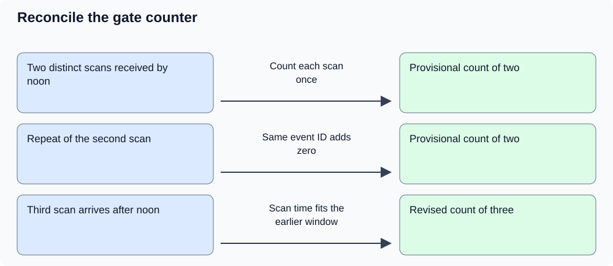
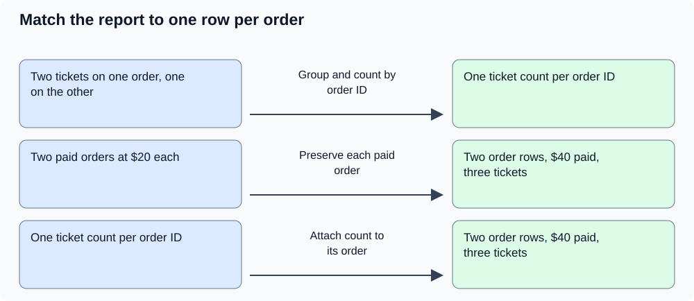

# DP-900 — Microsoft Azure Data Fundamentals: visual study pack

> **Independent AI-assisted resource — AI-GENERATED DRAFT; HUMAN REVIEW PENDING. Structural checks do not establish factual accuracy or renew source review. The official exam blueprint is authoritative.**

[Official exam blueprint](https://learn.microsoft.com/en-us/credentials/certifications/resources/study-guides/dp-900)

[Full library guide](https://github.com/cterpening/certification-study-library/blob/main/guides/DP-900-microsoft-azure-data-fundamentals.md) (current repository version; this package's exact source hash is recorded in manifest.json).

**Accepted objective baseline:** Skills measured as of July 21, 2026

**Blueprint last checked in the catalog:** 2026-10-28. This build performs no live source refresh.

**Scope:** Two county fair stories explore selected Azure Data Fundamentals objectives. Count arrivals across a delayed stream, then reconcile ticket sales across two relational tables.

**VERIFY CURRENT:** Recheck volatile product details and unresolved limitations in the source guide. A matching file hash does not establish current technical accuracy.

## How many people came through the gate?

A fairground supervisor needs a running count of admissions. A delayed gate scanner and a retried message change what the team can report about the first five minutes. Work out a provisional count, then decide what would justify revising it.

**Supporting sources:** [Explore fundamentals of real-time analytics](https://learn.microsoft.com/en-us/training/modules/explore-fundamentals-stream-processing/), [Structured Streaming](https://learn.microsoft.com/en-us/azure/databricks/structured-streaming/)

**Published objectives:**

- Describe the difference between batch and streaming data
- Describe considerations for data ingestion and processing

**Source-guide sections:** Batch and streaming; 4. Duplicate and late stream events; Lab 6: Replay without double counting

**Diagram in words:** Two distinct scans received by noon — Count each scan once → Provisional count of two; Repeat of the second scan — Same event ID adds zero → Provisional count of two; Third scan arrives after noon — Scan time fits the earlier window → Revised count of three

**Remember:**

- Batch processing works on a bounded collection of records. Stream processing keeps responding to arriving events. How soon someone must act helps decide which path fits the work.
- Event time gives the time of the scan. Arrival time gives the time the message reached the receiving system. A network delay can separate the two.
- Related item: Keep the business event's identity across a delivery retry. A separate admission with a new event ID still counts even when it happens at the same time or involves the same ticket.
- Related item: State the window and the late-data rule when publishing a count. A result can be provisional while the system still accepts delayed scans for that interval.

**Try it:** Two distinct admissions reach the counter before noon. One is delivered a second time. A third admission was scanned before noon but arrives just after it. The report groups by scan time and accepts that delay. What counts can staff describe before and after the late record?

**Answer and reasoning:** At noon staff know of two distinct admissions. The retry adds zero. The delayed third admission raises the count for the earlier interval to three. Staff can preserve both figures by labeling the first result provisional and the second revised.

## Two paid orders, three tickets, and an extra twenty dollars

The fair’s box office needs one report with money received and tickets issued. A join repeats the amount on a two-ticket order. Work out what one row represents before totaling it, then keep a paid order visible while its tickets are still being issued.

**Supporting sources:** [Primary and foreign key constraints](https://learn.microsoft.com/en-us/sql/relational-databases/tables/primary-and-foreign-key-constraints?view=sql-server-ver17), [SQL GROUP BY](https://learn.microsoft.com/en-us/sql/t-sql/queries/select-group-by-transact-sql?view=sql-server-ver17), [Explore fundamental relational data concepts](https://learn.microsoft.com/en-us/training/modules/explore-relational-data-offerings/)

**Published objectives:**

- Identify features of relational data
- Identify common structured query language (SQL) statements

**Source-guide sections:** Tables, keys, and relationships; SQL and database objects; 1. Customer identity and the grain of revenue; 2. Run the SQL example and undo an accidental change

**Diagram in words:** Two tickets on one order, one on the other — Group and count by order ID → One ticket count per order ID; Two paid orders at $20 each — Preserve each paid order → Two order rows, $40 paid, three tickets; One ticket count per order ID — Attach count to its order → Two order rows, $40 paid, three tickets

**Remember:**

- A primary key identifies an order. Each ticket can carry a foreign key referring to its order, so two distinct tickets can legitimately refer to the same payment.
- An inner join produces each matching pair. When two tickets match one order the result contains two rows for that order, each with the order amount.
- Sum payments at the order level. To report tickets alongside that amount, group tickets by order ID first and count the tickets in each group.
- A left join from orders preserves paid orders with no matching ticket group. Display a missing group’s count as zero when that is the agreed business meaning.

**Try it:** Two orders are paid twenty dollars each. One has two issued tickets and the other has one. What goes wrong if a report joins orders to tickets and sums the order amount? How would you keep an order visible before any tickets are issued?

**Answer and reasoning:** The three joined rows each show twenty dollars, producing sixty dollars from forty dollars of payments. Count or group tickets by order ID first. Start with paid orders, left join the per-order ticket counts, and treat a missing count as zero. The payment then appears once per order.

## Places to learn

The linked source guide and registered references are a curated starting point, not a complete list or a requirement to consume everything. This focused pack does not replace the complete guide or official objectives.
