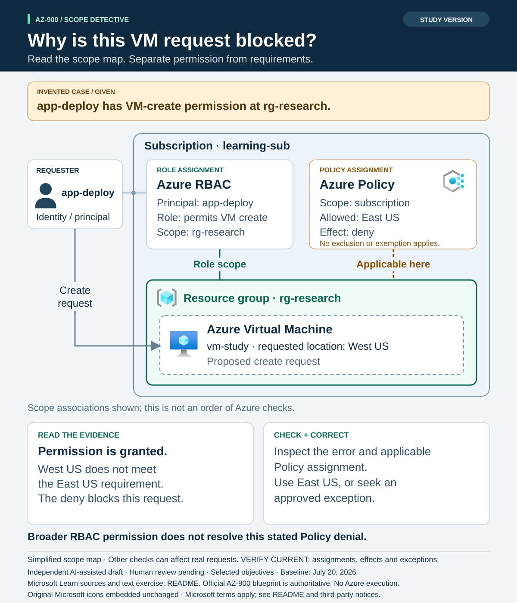
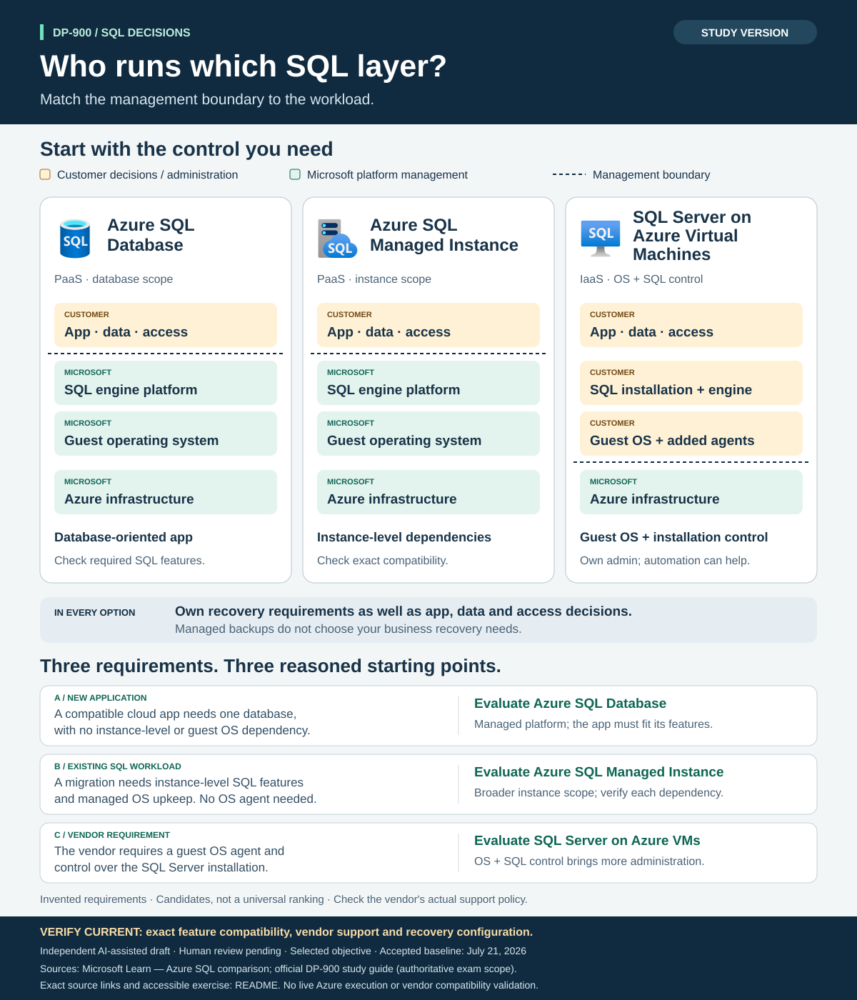
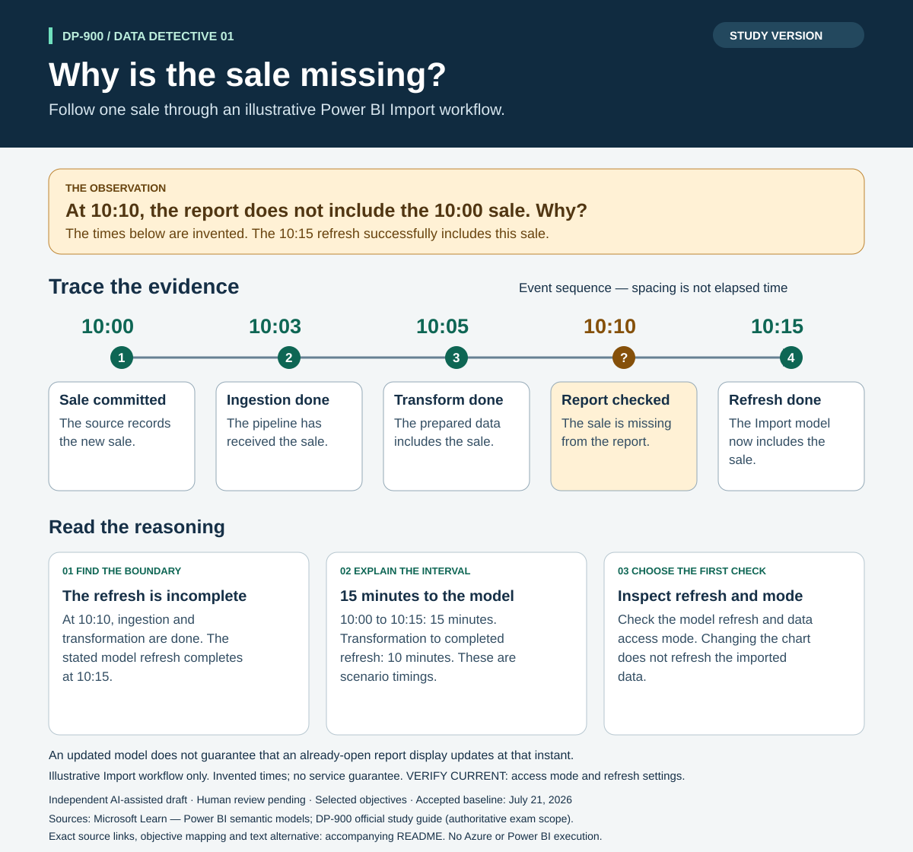

# Study and practice diagrams

> **Independent AI-assisted resource — AI-generated draft; human review pending.** These exercises cover selected topics. The official [AZ-900](https://learn.microsoft.com/en-us/credentials/certifications/resources/study-guides/az-900) and [DP-900](https://learn.microsoft.com/en-us/credentials/certifications/resources/study-guides/dp-900) blueprints define exam scope.

Open a practice sheet first and explain your answer, then compare it with the study
sheet. The files are editable SVGs and can be opened in a browser. The newer scope
and SQL diagrams embed the original selected Microsoft icons, so their SVG files
carry the images with them. Product labels and accessible descriptions remain part
of the exercise.

| Certification | Learning task | Study sheet | Practice sheet | Sources and text version |
|---|---|---|---|---|
| AZ-900 | Trace a blocked deployment across role and policy scopes | [Study](az-900-governance-scope/study.svg) | [Practice](az-900-governance-scope/practice.svg) | [Exercise](az-900-governance-scope/README.md) |
| DP-900 | Choose an Azure SQL management boundary | [Study](dp-900-sql-choices/study.svg) | [Practice](dp-900-sql-choices/practice.svg) | [Exercise](dp-900-sql-choices/README.md) |
| DP-900 | Explain why an ingested sale is missing from a report | [Study](dp-900-data-freshness/study.svg) | [Practice](dp-900-data-freshness/practice.svg) | [Exercise](dp-900-data-freshness/README.md) |

## AZ-900: scope and governance

## DP-900: SQL management choices

## DP-900: data freshness

## Expand from a learning need

The [AZ-900 study pack](../study-packs/az-900-governance/study-guide.md) also has
three original concept diagrams. The [DP-900 study pack](../study-packs/dp-900-data-decisions/study-guide.md)
has four. The scope and SQL pairs improve treatment of topics already selected;
they do not add new objective coverage merely by adding another format.

Use the [visual brief](../../docs/templates/VISUAL-STUDY-BRIEF.md) to identify the
next learner question. Prioritize these useful formats before increasing the count:

| Certification | Next candidate | Useful visual treatment |
|---|---|---|
| AZ-900 | Management locks, data operations, and recovery | Boundary diagram plus an original operation-classification exercise |
| AZ-900 | Resource tags, cost records, and access | Annotated record flow with a troubleshooting question |
| DP-900 | Blob objects, shared files, and document queries | Access-pattern matching exercise with remaining validation questions |
| DP-900 | Operational transactions and historical analysis | Two workload paths over the same business facts |

These candidates come from existing reviewed study-pack units. Broader expansion
requires mapping the remaining official objectives and reviewing the relevant
sources. Neither a diagram count nor completing a worksheet establishes exam
readiness. See [the production process](../../docs/STUDY-PRODUCTION.md) and
[Microsoft icon provenance and terms](../../docs/VISUAL-ASSETS.md).

The [dated review record](../../docs/research/2026-11-10-diagram-expansion.md)
documents the scope, independent AI reviews, and source/artifact hashes for the
new AZ-900 scope and DP-900 SQL pairs. Human review remains pending.
