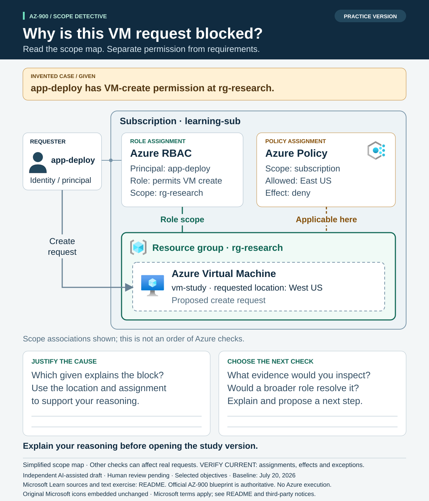
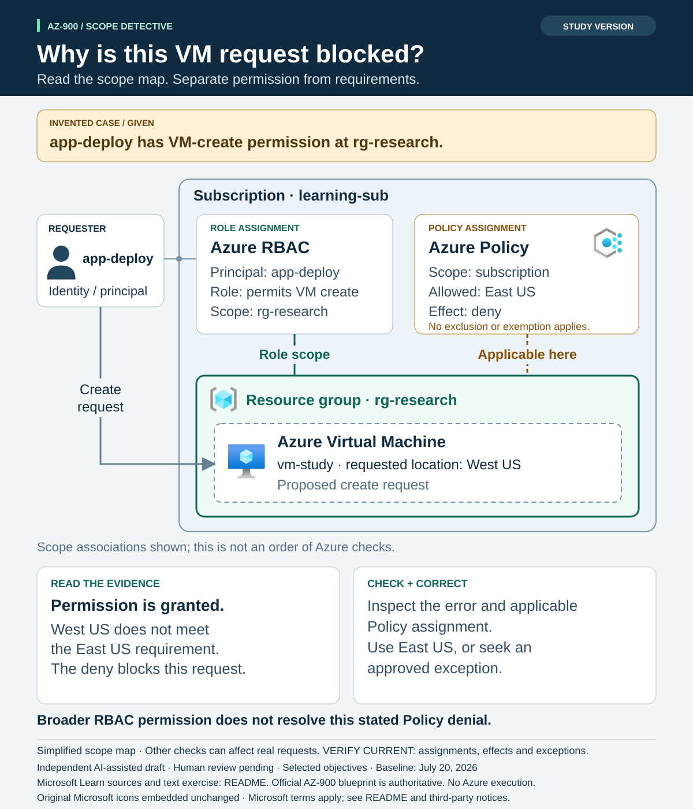

# AZ-900 visual exercise: why is this VM request blocked?

> **Independent AI-assisted resource — AI-GENERATED DRAFT; HUMAN REVIEW PENDING.** This exercise covers selected objectives, not the entire exam. The [official AZ-900 study guide](https://learn.microsoft.com/en-us/credentials/certifications/resources/study-guides/az-900) defines exam scope. Accepted baseline: **Skills measured as of July 20, 2026**. No live Azure execution is claimed.

Use the [practice map](practice.svg), explain your answer, and then open the
[study map](study.svg). Both are standalone 1200 × 1400 SVGs. The nested boundaries
show the target scope; separate connections show the role assignment and applicable
Policy assignment. The connectors do not represent an order of Azure checks.



## Practice without the image

This is an original, invented scenario. The subscription is `learning-sub`; its
resource group `rg-research` is the intended target of a new virtual machine.

| Given | Scenario evidence |
|---|---|
| Requester | The identity `app-deploy` has the required VM-create permission at `rg-research`. |
| Azure RBAC role assignment | Principal `app-deploy` is associated with a role that permits VM creation, scoped to `rg-research`. The role description is a scenario shorthand, not a named built-in role. |
| Azure Policy assignment | A separate policy is assigned at subscription scope. It allows East US and uses the `deny` effect for other locations. It applies to this request; no exclusion or exemption applies. |
| Proposed configuration | Create Azure Virtual Machine `vm-study` in `rg-research`, using West US. The dashed box is a request, not a deployed VM. |
| Observation | The create request is blocked. |

1. Which given explains the block? Use the requested location and applicable
   assignment to support your reasoning.
2. What evidence would you inspect next?
3. Would a broader role resolve the stated issue? Explain and propose a next step.

The map is a simplified view of scope relationships. It does not claim to show
every check that can affect a real request. **VERIFY CURRENT:** inspect the actual
assignments, effects, exclusions and exemptions in the intended environment.

## Study answer and explanation



The identity already has the stated permission. The proposed **West US** location
does not satisfy the applicable **East US** requirement, so the configured deny
blocks this request. Broader RBAC permission does not resolve that restriction.
Microsoft documents that [Azure Policy can block a noncompliant create or update
even when the identity has permission](https://learn.microsoft.com/en-us/azure/governance/policy/overview).

Inspect the actual error, requested configuration and applicable assignment,
including its scope and effect. Use an approved location or follow the
organization's legitimate exception process. This is an explanation of the stated
failure, not a claim that satisfying this requirement guarantees deployment.

An acceptable answer connects the principal, role and target scope; identifies
the location mismatch; and chooses relevant evidence before changing access.
The exercise does not imply that Policy can never inspect identity. The current
[Policy overview](https://learn.microsoft.com/en-us/azure/governance/policy/overview)
also describes identity-aware rules; this example concerns a location rule.

## Objective mapping and evidence

| Exact published objective | What the learner explains |
|---|---|
| Describe Azure role-based access control (RBAC) | How a principal, role definition and scope are associated in a role assignment. |
| Describe the purpose of Azure Policy | Why an applicable governance requirement can block the proposed configuration. |

The [Azure RBAC overview](https://learn.microsoft.com/en-us/azure/role-based-access-control/overview)
supports the principal–role–scope relationship. The
[Azure Policy overview](https://learn.microsoft.com/en-us/azure/governance/policy/overview)
supports assignment scope, effects and location restrictions. These registered
sources (`azure-rbac-overview`, `azure-policy-overview`) were read for this bounded
exercise on **November 10, 2026**. Source reading is separate from human review or
live product execution. The rules and names in the scenario are invented inputs;
the diagram does not reproduce a vendor diagram or an exam item.

This exercise reuses the unchanged `permissions-and-policy` unit in the
[AZ-900 governance study package](../../study-packs/az-900-governance/study-guide.md).
The package binds the [complete library guide](../../../guides/AZ-900-microsoft-azure-fundamentals.md),
especially **Authentication and authorization**, **Governance controls**,
**Apply governance controls at the correct scope**, and
**Worked example 6 — permission, policy, lock and data protection**.
The [completed brief](brief.md) records exact input hashes and the design decision.

## Build and reuse

From the repository root:

```powershell
python examples/visual-exercises/az-900-governance-scope/build.py
python examples/visual-exercises/az-900-governance-scope/build.py --check
```

The builder uses the shared `scripts/visual_exercise.py` helper. It validates the
upstream study package, requires the bound source-unit hash, embeds selected
original icon bytes and records source, renderer, helper and output hashes in
[manifest.json](manifest.json). The check command compares regenerated artifacts
without writing. A source-unit change requires reviewing the visual and answers
before updating the expected hash. Generation and integrity checks do not renew
technical review or establish human approval.

The Azure resource group, Azure Policy and Azure Virtual Machine symbols are
original Microsoft artwork, embedded unchanged and visibly labeled. They remain
subject to the supplied [Microsoft terms](../../../website/assets/study-icons/notices/Microsoft_Terms_of_Use.pdf)
and [third-party notices](../../../THIRD-PARTY-NOTICES.md). The requester geometry,
layout, prose and scope connections are independently authored. No Microsoft
endorsement is implied. See [visual-asset guidance](../../../docs/VISUAL-ASSETS.md).
