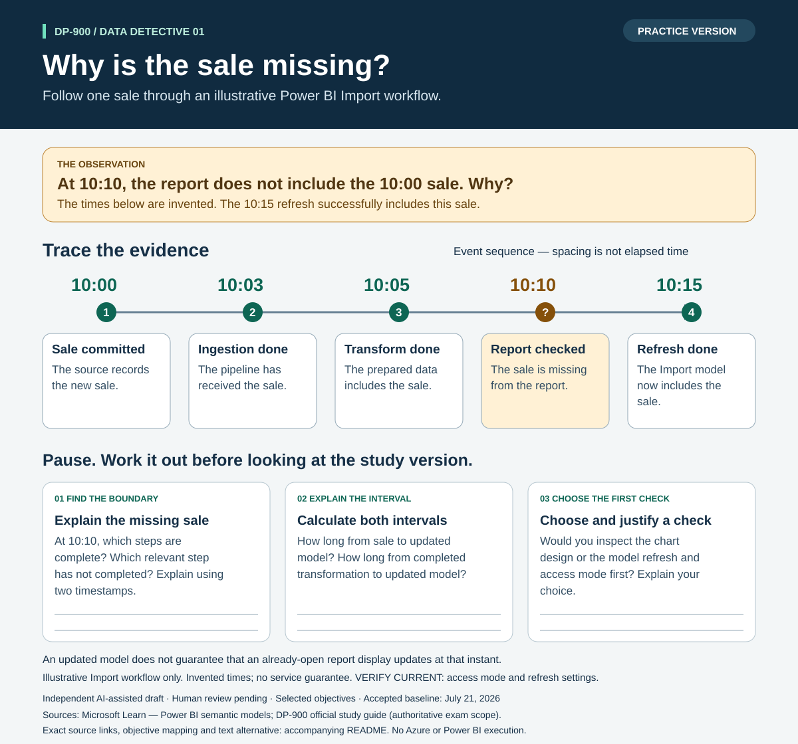
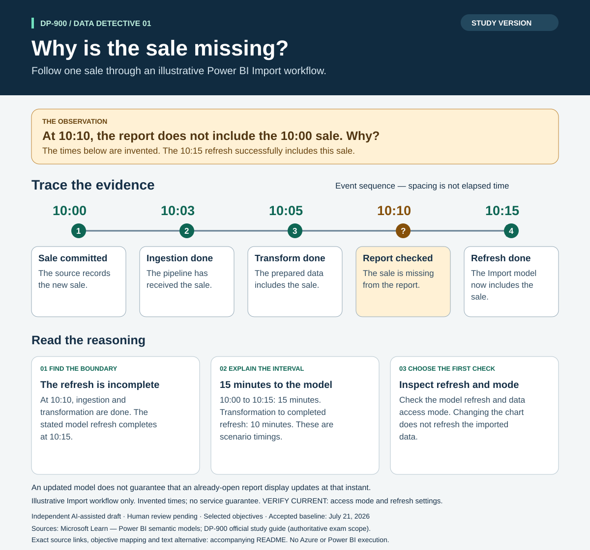

# DP-900 visual exercise: why is the sale missing?

> **Independent AI-assisted resource — AI-GENERATED DRAFT; HUMAN REVIEW PENDING.** This is selected-objective practice, not complete exam coverage. The [official DP-900 study guide](https://learn.microsoft.com/en-us/credentials/certifications/resources/study-guides/dp-900) defines exam scope. Accepted baseline: July 21, 2026.

Use the [practice sheet](practice.svg) first, then compare your explanation with the
[study sheet](study.svg). Both are editable SVG files that open in a browser and
can be printed. The exercise uses the same scenario as the fourth chapter of our
[DP-900 study pack](../../study-packs/dp-900-data-decisions/study-guide.md).



## Practice without the image

An invented bookshop workflow uses a Power BI Import model. Assume that the stated
successful 10:15 model refresh includes this sale. Event spacing in the diagram is
not a scaled measure of time.

| Time | Evidence provided by the scenario |
|---|---|
| 10:00 | The sale is committed in the source. |
| 10:03 | Ingestion has received the sale. |
| 10:05 | Transformation is complete; the prepared data includes the sale. |
| 10:10 | Someone checks the report, which does not include the sale. |
| 10:15 | The Import-model refresh completes and the model includes the sale. |

1. At 10:10, which steps are complete? Which relevant step has not completed?
   Explain using two timestamps.
2. How long from the sale to the updated model? How long from completed
   transformation to the updated model?
3. Would you inspect chart design or the model refresh and data access mode first?
   Explain your choice before opening the study sheet.

All times are invented learning inputs, not measured Azure/Power BI performance or
a service guarantee. An updated model does not guarantee that an already-open
report display updates at that instant; see Microsoft's distinction between
[data refresh and report-visual refresh](https://learn.microsoft.com/en-us/power-bi/connect-data/refresh-data).
**VERIFY CURRENT:** actual access mode,
refresh settings, and report behavior must be checked for a real implementation.

## Study sheet and explanation



At 10:10 the source, ingestion, and transformation steps are complete, while the
stated model refresh completes at 10:15. The intervals are **15 minutes from sale
to updated model**, and **10 minutes from transformation to updated model**. Begin
with the refresh and access mode. Editing the chart does not refresh imported data.
Microsoft documents that [Import models require refresh to keep their data current](https://learn.microsoft.com/en-us/power-bi/connect-data/service-datasets-understand).

An acceptable explanation identifies the unfinished boundary, calculates both
intervals, and separates data availability in the model from the visible report
updating. These are original learning questions, not recalled exam items.

## Objective mapping and evidence

| Published objective | What this exercise practices |
|---|---|
| Describe considerations for data ingestion and processing | Follow evidence across ingestion and transformation boundaries. |
| Describe features of data models in Power BI | Explain the role of Import-model refresh in this scenario. |

The [complete library guide](../../../guides/DP-900-microsoft-azure-data-fundamentals.md)
provides the broader context under **Follow the evidence through the pipeline**,
**Power BI concepts**, and **6. Trace a freshness problem**. The exercise reuses the
registered sources `dp900-3-analytics-unit` and `microsoft-power-bi-semantic-models`.
The [ingestion lesson](https://learn.microsoft.com/en-us/training/modules/examine-components-of-modern-data-warehouse/3-data-ingestion-pipelines)
supports the pipeline distinction; the semantic-model documentation supports
Import refresh. Both were read for this bounded exercise on November 10, 2026.
The registered `pl300-refresh-data` reference was also read for the supporting
model-versus-display caveat; this does not add a DP-900 objective.
No video, assessment, Azure deployment, or Power BI execution is claimed.

## Repeat the process

The [completed visual brief](brief.md) records the learning design. Copy the
[reusable brief template](../../../docs/templates/VISUAL-STUDY-BRIEF.md) for another
topic, read its source material, choose a suitable visual form, and produce both
the explanation and the practice version. Use the existing study-pack builder for
standard node/edge diagrams; this example's renderer is a custom timeline layout.
It does not automatically select a format or author a new infographic.

From the repository root:

```powershell
python examples/visual-exercises/dp-900-data-freshness/build.py
python examples/visual-exercises/dp-900-data-freshness/build.py --check
```

The first command regenerates the two SVGs and their manifest. The second checks
current inputs and outputs without writing. The renderer validates the upstream
study package and requires this exact source-unit version. A source-unit change
requires review of the brief, answers, labels and source evidence before updating
the expected hash in the renderer. Rebuilding is not factual or human review.

Generation and review evidence is recorded in [review.md](review.md).
