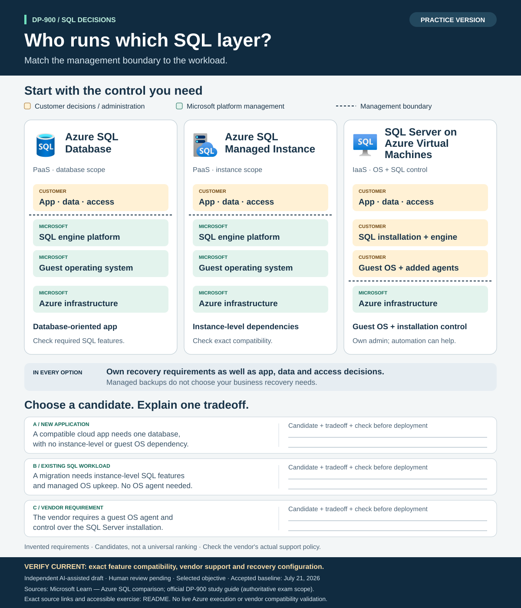
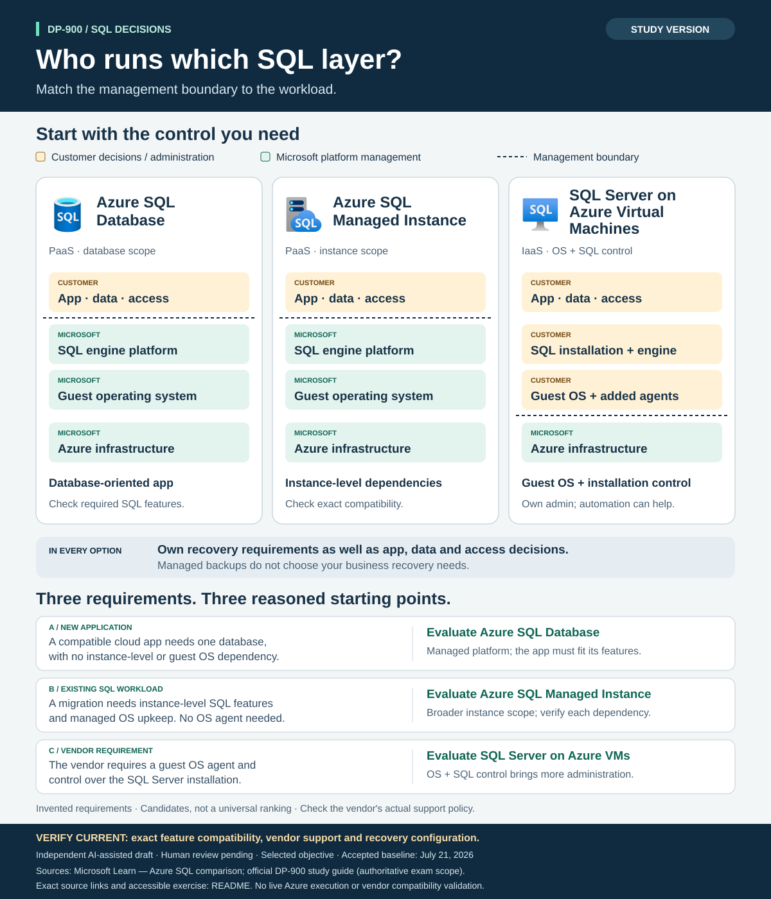

# DP-900 visual exercise: who runs which SQL layer?

> **Independent AI-assisted resource — AI-GENERATED DRAFT; HUMAN REVIEW PENDING.** Selected-objective practice, not complete exam coverage. The [official DP-900 study guide](https://learn.microsoft.com/en-us/credentials/certifications/resources/study-guides/dp-900) defines exam scope and is authoritative. Accepted objective baseline: **July 21, 2026**.

Use the [practice sheet](practice.svg), explain your choices, then open the
[study sheet](study.svg) or the separate answer section below. The three columns
compare the same layers, with customer and Microsoft responsibilities written on
each layer. The dashed line marks the shift to Microsoft-managed platform layers.
These are candidate choices, not a universal ranking.



## Practice without the image

Read the columns from the application down to Azure infrastructure. The top layer
represents customer decisions about the application, data and access; it does not
mean that an application is hosted inside the database service.

| Layer or distinction | Azure SQL Database | Azure SQL Managed Instance | SQL Server on Azure Virtual Machines |
|---|---|---|---|
| Application, data and access | Customer | Customer | Customer |
| SQL platform maintenance | Microsoft manages the engine platform | Microsoft manages the engine platform | Customer controls the SQL installation and engine |
| Guest operating system | Microsoft manages it; no customer guest OS access | Microsoft manages it; no customer guest OS access | Customer manages the guest OS and can install agents |
| Azure infrastructure | Microsoft | Microsoft | Microsoft |
| Starting point to evaluate | Database-oriented application | Instance-level SQL Server dependencies | Guest OS and SQL installation control |

The [Microsoft Azure SQL comparison, especially **Administration** and the comparison table](https://learn.microsoft.com/en-us/azure/azure-sql/azure-sql-iaas-vs-paas-what-is-overview)
supports these distinctions. Database and Managed Instance include platform
maintenance and built-in backups. In every option, customers still own application,
data, access and recovery decisions, including database administration, workload
tuning and security configuration. VM automation can assist patching, backup and
availability; additional customer responsibility does not mean every task is manual.

The following requirements are invented learning inputs. They do not establish
that any real application or vendor is compatible. For each, **choose a candidate,
explain one tradeoff, and identify a check before deployment**:

1. **New application:** A compatible cloud app needs one database, with no
   instance-level or guest OS dependency.
2. **Existing SQL workload:** A migration needs instance-level SQL features and
   managed OS upkeep. No guest OS agent is required.
3. **Vendor requirement:** An application vendor requires an agent in the guest
   OS and control over the SQL Server installation.

**VERIFY CURRENT:** exact feature compatibility and vendor support, engine
versions, service limits and recovery configuration. An unnamed vendor's policy
cannot be verified from this scenario. Check its current support matrix and test
the exact application and agent in an authorized environment.

## Study answers and rationale



1. **Evaluate Azure SQL Database.** The stated app needs a managed database
   without the additional control described in the other requirements. Microsoft
   maintains the platform; the app must fit the supported database features.
2. **Evaluate Azure SQL Managed Instance.** Its broader instance-level
   compatibility is a useful starting point while Microsoft maintains the
   platform. The tradeoff is giving up guest OS control. Confirm each required
   SQL feature; “managed instance” does not prove
   full application compatibility.
3. **Evaluate SQL Server on Azure Virtual Machines.** The stated guest OS and SQL
   installation requirements need that control boundary. The team accepts the
   corresponding administration and recovery work, with automation available.
   Confirm that the vendor actually supports the chosen Azure VM configuration,
   SQL version and agent before treating this as a deployment decision.

The [official comparison](https://learn.microsoft.com/en-us/azure/azure-sql/azure-sql-iaas-vs-paas-what-is-overview)
supports these conditional starting points. A good answer connects the requirement
to a layer of control, names the operational consequence, and states what remains
unverified. Other candidates require additional assumptions and evidence. No option
is universally best, and no service label removes customer data or access decisions.
The questions are original practice, not remembered exam items or exam predictions.

## Exact objective and evidence

This exercise maps only this published objective:

> Describe the Azure SQL family of products, including Azure SQL Database, Azure SQL Managed Instance, and SQL Server on Azure Virtual Machines

The broader source unit also discusses relational design; this exercise does not
claim to cover its normalization or relational-data objectives.

| Evidence | Exact binding and scope |
|---|---|
| Library guide | [Azure relational services / Choose the management boundary before the SKU](../../../guides/DP-900-microsoft-azure-data-fundamentals.md#choose-the-management-boundary-before-the-sku) |
| Source package | [DP-900 data decisions](../../study-packs/dp-900-data-decisions/study-guide.md), unchanged `relational-management` unit in [units.json](../../study-packs/dp-900-data-decisions/units.json) |
| Technical source | Registered `microsoft-azure-sql-options-overview`: [What is Azure SQL?](https://learn.microsoft.com/en-us/azure/azure-sql/azure-sql-iaas-vs-paas-what-is-overview), **SQL Database**, **SQL Managed Instance**, **SQL Server on Azure VMs**, **Comparison table**, and **Administration** |
| Bounded evidence read | November 10, 2026; first-party management/control distinctions confirmed. No vendor-specific support claim or live Azure execution. |
| Original service icons | Microsoft `azure-sql-database`, `azure-sql-managed-instance`, `sql-server-on-azure-vm`, embedded unchanged from the [accepted icon bundle](../../../website/assets/study-icons/manifest.json). See [asset guidance and terms](../../../docs/VISUAL-ASSETS.md). No endorsement is implied. |

The unit is bound using `study_material.json_text` and normalized UTF-8 SHA-256:
`e507e0e26816ca2acd4009f4e537a9538d8638e86a399c7744edeed6db05ac22`.
The generated [manifest](manifest.json) binds both SVGs, the builder, source
package, shared helper and original icon bytes. Artifact integrity is separate
from factual review and human review.

## Rebuild

From the repository root:

```powershell
python examples/visual-exercises/dp-900-sql-choices/build.py
python examples/visual-exercises/dp-900-sql-choices/build.py --check
```

The builder uses local inputs and the shared visual-exercise helper. It makes no
network or AI calls. A changed source unit fails the binding check and requires
content review before accepting a new hash. [The completed brief](brief.md)
records the design, qualifications and evidence. Rebuilding does not establish
technical correctness, independent review or human review.
